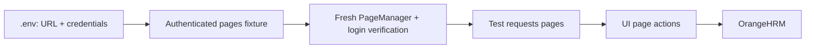

# Simple OrangeHRM automation

A small Playwright TypeScript project using **tests**, **pages**, **.env**, and one
authenticated **pages** fixture. There are no saved login states or setup projects.

## Automatic login with PageManager

**BasePage** holds the browser page and shared navigation. **LoginPage** and
**DashboardPage** provide UI locators and actions. **PageManager** creates both
objects in one place.

**fixtures/authenticatedTest.ts** creates a fresh PageManager, opens the login page,
logs in with the .env credentials, verifies the dashboard heading, and supplies
the manager to the test. Authentication completes before the test body starts.
A login failure fails the test during setup.



```ts
import { test, expect } from '../fixtures/authenticatedTest';

test('dashboard is available', async ({ pages }) => {
  await expect(pages.dashboardPage.menuItem('Dashboard')).toBeVisible();
});
```

There is no beforeEach hook or object construction in authenticated specs.
Request the built-in page as well when needed: async ({ page, pages }) => { ... }.

The fixture is **test-scoped**: every test that requests pages gets a new manager,
fresh browser context, and a fresh login. Retries also start fresh. Page objects
within one test share that test's page; objects are never shared across tests.
Playwright closes its page/context after completion or failure.

The fixture is **lazy**: a test requesting only page does not trigger authentication.
Use { pages } whenever the test requires an authenticated session.

### Login-validation tests stay unauthenticated

tests/login.spec.ts deliberately imports test from @playwright/test. Its beforeEach
creates a PageManager and opens the login form without signing in. This allows tests
to exercise valid/invalid credentials and required-field validation directly.

Use the authenticated test import for business scenarios after login. Use the native
Playwright test import for login, anonymous-access, or other unauthenticated scenarios.

## Start

Open a terminal in C:\Users\sayeshai\Documents\ChatGPT\SimplePlaywright.

```sh
npm ci
npx playwright install chromium firefox webkit
```

Copy .env.example to .env if .env does not exist. The current .env is configured for
the public OrangeHRM demo:

```dotenv
BASE_URL=https://opensource-demo.orangehrmlive.com/web/index.php/
TEST_USERNAME=Admin
TEST_PASSWORD=admin123
```

Then run:

```sh
npm test
npm run report
```

Node.js 22+ is required. Linux without the Docker image may need
npx playwright install --with-deps chromium firefox webkit. The demo requires internet access and can
be reset or changed by other users. Its displayed public credentials are not private
credentials; real application passwords must remain in ignored .env or Jenkins Credentials.

## Test coverage

| File | Scenarios |
| --- | --- |
| tests/login.spec.ts | Successful login; invalid credentials; both fields empty; username missing; password missing |
| tests/dashboard.spec.ts | Sidebar search and clearing; logout followed by protected-page navigation |

The tests inspect UI behavior and do not create, edit, or delete employee records.
Worker count and parallelism follow playwright.config.ts. For a low-load run against the shared demo, use npx playwright test --workers=1. Assertions target
stable roles, placeholders and visible text, not employee names or dashboard counts.
The user menu uses its observed CSS class because it has no accessible button name.

## Add another page and test

1. Add a UI class under pages/, extending BasePage if it needs common navigation.
2. Import it in PageManager.ts, declare a readonly property, and construct it there.
3. In an authenticated spec, import test/expect from ../fixtures/authenticatedTest and request { pages }. For an anonymous spec, use native Playwright test with a PageManager in beforeEach.
4. Call the page methods from tests and keep expected outcomes in expect assertions.

Pages contain UI locators/actions only. The fixture reads login credentials; tests assert
business outcomes. BasePage deliberately has no redundant wrappers around click,
fill or expect: Playwright already handles waiting for UI actions.

## Files

```text
SimplePlaywright/
  fixtures/
    authenticatedTest.ts
  pages/
    BasePage.ts
    PageManager.ts
    LoginPage.ts
    DashboardPage.ts
  tests/
    login.spec.ts
    dashboard.spec.ts
  .env
  .env.example
  playwright.config.ts
  package.json
  package-lock.json
  tsconfig.json
  Jenkinsfile
  README.md
```

## Browser projects

Select chromium, firefox, webkit, chrome, or msedge using --project or the project selector in Playwright UI. Google Chrome and Microsoft Edge must be installed on the machine. They use the chrome/msedge channels; chromium uses the Playwright-managed browser. npm test selects all five projects. See https://playwright.dev/docs/browsers for browser installation details.

## Commands and reports

| Command | Purpose |
| --- | --- |
| npm test | Run seven tests on each of five browsers (35 total) |
| npx playwright test --project=chromium | Run Chromium only |
| npx playwright test --project=firefox | Run Firefox only |
| npx playwright test --project=webkit | Run WebKit only |
| npx playwright test --project=chrome | Run installed Google Chrome only |
| npx playwright test --project=msedge | Run installed Microsoft Edge only |
| npm run test:headed | Show the browser |
| npm run test:debug | Debug interactively |
| npm run test:ui | Interactive runner with browser project selection |
| npx playwright test tests/login.spec.ts | Run login scenarios only |
| npm run typecheck | Check TypeScript |
| npm run report | View the latest report |

Shell/Jenkins variables override .env. BASE_URL is the application base, not the full
login URL, and must end in /. Page methods append auth/login and dashboard/index.

Failures retain screenshots/traces in test-results. The HTML report is in
playwright-report; JUnit XML is in test-results/junit.xml. Traces may include passwords,
cookies or application data, so restrict access. CI forbids test.only and retries once;
a flaky test still fails the build. No hard sleeps or swallowed failures are used.

## Jenkins

The standalone Jenkinsfile runs npm ci, typecheck and tests using a matching Playwright
Docker image. The supplied Jenkins command selects chromium, firefox and webkit, which are bundled in that image. It uses xvfb-run for your headed configuration. To run chrome or msedge in Jenkins, provision those branded browsers in the agent image and select their projects.
Use a Linux agent labeled docker, with Pipeline, Git, Docker Pipeline
and JUnit plugins and outbound access to OrangeHRM and the npm/container registries.

Its environment section supplies the public demo URL/credentials because .env is
not committed. For a private app, remove those public defaults and bind TEST_USERNAME
and TEST_PASSWORD through Jenkins Credentials. Use Jenkinsfile as the script path.
The pipeline clears a dedicated workspace before checkout, disables concurrent builds,
and archives reports. No deployment stage is included and no Jenkins job was run.

Application inspected: [OrangeHRM demo](https://opensource-demo.orangehrmlive.com/web/index.php/auth/login).
